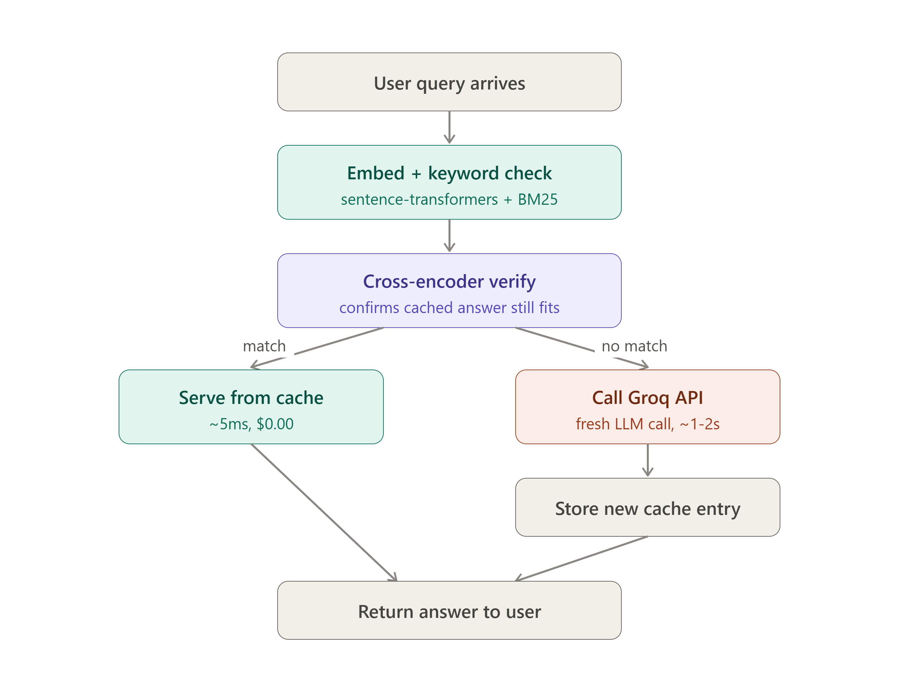

# Semantic-Shift : Semantic Cache Pipeline

> **Slash LLM API costs and latency by intelligently reusing past answers — without sacrificing accuracy.**

A caching proxy that sits in front of an LLM API (Groq) and uses a **four-layer verification pipeline** to decide whether a new query can safely reuse a cached answer. Unlike naive string-matching caches, this system understands that _"How do I reset my password?"_ and _"What are the steps to recover my password?"_ mean the same thing — while correctly rejecting _"How do I delete my account?"_ even though it shares 4 of its 6 words.

<p align="center">
  
</p>

---

## Key Features

- **4-Layer Semantic Verification** — Exact Match → Cosine Similarity → BM25 sanity check → Cross-Encoder re-ranking
- **Duplicate Question Detection** — Cross-encoder trained on Quora Question Pairs distinguishes _same intent_ from _same topic_
- **Embedding Cache** — In-memory dict caches all embeddings, so repeated queries cost < 1ms
- **Real-Time Dashboard** — KPI cards, query log table, and a live query tester (HTML/JS, served by FastAPI)
- **Live Threshold Tuning** — Adjust all three verification thresholds via sliders without restarting the server
- **Backend Health Monitor** — Live connection status indicator
- **Cost & Time Tracking** — Estimated dollars saved and time saved updated per request
- **SQLite Persistence** — Cache survives server restarts with ACID guarantees
- **Single-Command Startup** — One `uvicorn` command serves both the API and the dashboard UI

---

## Architecture

```
User Query
    │
    ▼
┌──────────────────────────────────────────────────────────────────────────┐
│                    FastAPI Backend (backend/main.py)                      │
│                                                                          │
│   ┌──────────────┐                                                       │
│   │  Layer 0      │                                                       │
│   │  Exact & Typo │  ── string/char match ──▶  INSTANT HIT (< 1ms)      │
│   │  Match        │                                                       │
│   └──────┬───────┘                                                       │
│          │ no match                                                       │
│          ▼                                                                │
│   ┌──────────────┐    ┌──────────────────┐    ┌───────────────────────┐  │
│   │  Layer 1      │    │  Layer 2          │    │  Layer 3               │  │
│   │  Cosine       │ ──▶│  BM25             │ ──▶│  Cross-Encoder         │  │
│   │  Similarity   │    │  Sanity Check     │    │  Re-ranking            │  │
│   │  (embedding)  │    │  (keyword)        │    │  (intent matching)     │  │
│   └──────────────┘    └──────────────────┘    └───────────────────────┘  │
│         │                     │                        │                  │
│    Fast vector match    Confirms overlap        Confirms intent           │
│    (threshold: 0.72)    for borderline cases    (catches traps)          │
│                                                                          │
│   ┌──────────────┐    ┌──────────────────┐                               │
│   │  Groq LLM    │    │  SQLite Cache     │                               │
│   │  (on miss)   │    │  (persistent)     │                               │
│   └──────────────┘    └──────────────────┘                               │
└──────────────────────────────────────────────────────────────────────────┘
    │
    ▼
┌──────────────────────────────────────────────────────────────────────────┐
│                   HTML Dashboard (frontend/index.html)                   │
└──────────────────────────────────────────────────────────────────────────┘
```

### Why Four Layers?

| Layer                           | Algorithm                                                      | Speed                         | Purpose                                                                                                                                                                                |
| ------------------------------- | -------------------------------------------------------------- | ----------------------------- | -------------------------------------------------------------------------------------------------------------------------------------------------------------------------------------- |
| **Layer 0** — Exact/Typo Match  | Normalized string compare & SequenceMatcher (typo cutoff 0.95) | < 1ms exact, ~15ms typo path  | Instant return for identical queries. Minor typos (`pythn` → `python`) are matched after the embedding step, only when the cosine match falls below its threshold.                     |
| **Layer 1** — Cosine Similarity | `all-MiniLM-L6-v2` embeddings (384-dim, L2-norm)               | ~13ms (embed + cosine)        | Vectorized `np.dot` finds the semantically closest match instantly among all cached entries.                                                                                           |
| **Layer 2** — BM25              | Keyword overlap (TF-IDF)                                       | ~1-5ms                        | Sanity check for borderline cosine scores. Adds keyword-overlap evidence to the debug trace; the accept/reject decision is made by the cross-encoder.                                  |
| **Layer 3** — Cross-Encoder     | `quora-distilroberta-base` pairwise scoring                    | ~30ms (43ms vs 13ms pipeline) | Confirms **intent** equivalence — not just topic similarity. Example: _"history of machine learning"_ vs _"what is machine learning"_ scores 0.733 and is rejected at the 0.75 cutoff. |

**Layer 3 is selectively skipped** when cosine similarity >= 0.88 (none of the 15 benchmark traps scored this high), saving ~30ms.

**Total complexity:** Vectorized numpy operations + fallback ML = **fast AND accurate**.

---

## Quick Start

### Prerequisites

- Python 3.11+
- A [Groq API key](https://console.groq.com/) (free tier works)

### 1. Clone & Install

```bash
git clone https://github.com/Adinath-Jagtap/Semantic-Shift.git
cd Semantic-Shift

python -m venv .venv
# Windows:
.venv\Scripts\activate
# macOS/Linux:
source .venv/bin/activate

pip install -r requirements.txt
```

### 2. Configure Environment

```bash
cp .env.example .env
```

Edit `.env` and add your Groq API key:

```env
GROQ_API_KEY=gsk_your_key_here
```

### 3. Start the Server

```bash
uvicorn backend.main:app --reload
```

The server will:

- Load both ML models at startup (embedding + cross-encoder)
- Warm the embedding cache from SQLite
- **Fail fast** with a clear error if `GROQ_API_KEY` is missing
- Log all loaded configuration values
- Serve the dashboard UI at the root URL

### 4. Open the Dashboard

Navigate to **http://localhost:8000** in your browser.

### 5. Run Tests

```bash
pytest tests/ -v
```

---

## The Trap-Pair Demo

This is the demo that proves the system works. Try these queries in the Query Tester:

1. **First query:** `"How do I reset my password?"`
   - Result: **CACHE MISS** — no cached entries yet, calls the LLM (~10s median with `openai/gpt-oss-20b` in the benchmark)

2. **Second query:** `"What are the steps to recover my password?"`
   - Result: **CACHE HIT** — the system recognizes this is the same question, returns the cached answer in ~28ms (median paraphrase hit, Run 2) instead of ~10s (~370x faster)

3. **Third query:** `"How do I delete my account?"`
   - Result: **CACHE MISS** — it shares 4 of its 6 words with query 1, but its cosine similarity (0.58) is below the 0.72 threshold, so the cache match is rejected before the cross-encoder is reached

4. **Fourth query:** `"How do I reset my password?"` (exact repeat)
   - Result: **CACHE HIT** — exact match short-circuit, **< 1ms latency** (0.05ms median), zero ML

A naive string-matching cache misses the paraphrase in query 2. Look-alike pairs that score high on cosine similarity — for example _"history of machine learning"_ vs _"what is machine learning"_ (0.745) — are what the cross-encoder layer is for; see the benchmark below.

---

## Latency Breakdown

_Server-side latencies measured in Run 1 (online backend, `openai/gpt-oss-20b`); speedup is relative to the median cache-miss latency (9,963 ms). Hit counts include the false hits of that run._

| Scenario                                     | Latency (median)              | Path                                  | Speedup vs LLM |
| -------------------------------------------- | ----------------------------- | ------------------------------------- | -------------- |
| Exact repeat                                 | **0.02 ms** (p95 0.17 ms)     | Layer 0 (string match)                | > 100,000x     |
| Typo match (n = 3)                           | **~15 ms**                    | Layer 0 (char match, after embedding) | ~650x          |
| Paraphrase, high confidence (cosine >= 0.88) | **~13 ms** (p95 22 ms)        | Embed + cosine (CE skipped)           | ~770x          |
| Paraphrase, borderline pipeline              | **~43 ms** (p95 50 ms)        | Embed + cosine + BM25 + cross-encoder | ~230x          |
| Cache miss                                   | **~9,963 ms** (p95 15,480 ms) | Embed once + LLM API call             | 1x (baseline)  |

> **Note:** Semantic hits are bounded by CPU neural-network inference: 13-43 ms median on the online backend, 27.82 ms median paraphrase hits on the local server (Run 2). Cache miss latency is dominated by the LLM call.

---

## Empirical Benchmark & Parameter Tuning Results

To validate the cache under real-world and adversarial conditions, we benchmarked the system across 90 requests spanning 15 canonical queries, 45 paraphrases, 15 adversarial semantic traps, and 15 exact repeats ([`tests/benchmark.py`](tests/benchmark.py) & [`tests/calibrate.py`](tests/calibrate.py); raw output in [`tests/results_run1.json`](tests/results_run1.json) for Run 1 and [`tests/results.json`](tests/results.json) for Run 2). Both runs used the same LLM (`openai/gpt-oss-20b`).

Here is the full documented progression from the baseline run (original backend, online deployment) to the calibrated zero-trap configuration (changed parameters, local server):

### Run 1: Initial Benchmark (Before Calibration / Baseline Defaults)

_Measured from 90 requests across 15 distinct query intents (`benchmark.py`) against the online deployment of the original backend, with default settings (`char_thresh=0.85`, `crossencoder=0.25`, `cosine=0.72`). Latencies are server-side._

| Scenario              | Server Latency (Median) | p95 Latency  | Path                           | Speedup vs LLM |
| --------------------- | ----------------------- | ------------ | ------------------------------ | -------------- |
| Exact repeat          | **0.02 ms**             | 0.17 ms      | Layer 0 (string short-circuit) | > 100,000x     |
| Paraphrase hit        | **30.05 ms**            | 48.91 ms     | Embed + Cosine / Cross-Encoder | ~330x          |
| Cache miss (LLM call) | **9,962.78 ms**         | 15,480.24 ms | Embed once + LLM API call      | 1x (baseline)  |

> **Benchmark Summary (Run 1):**
>
> - **Paraphrase Hit Rate:** 84.4% (38 / 45)
> - **LLM Calls Avoided:** 67.8% (61 / 90 total queries)
> - **Trap False-Positive Rate:** 46.7% (7 / 15 traps) — _valuable material demonstrating why threshold tuning and multi-layer filtering matter!_
> - _Context:_ The 2024 arXiv paper _GPT Semantic Cache_ (arXiv:2411.05276) reports cache hit rates of 61.6%–68.8% using embedding similarity on its own query set. Those figures use a different method, dataset and metric, so they are cited for context only and are not directly comparable to this benchmark.

---

### Run 2: Calibrated Benchmark (Zero-Trap Parameters)

_Measured from 90 requests across 15 distinct query intents on a local server (`benchmark.py` & `calibrate.py`) with calibrated settings (`char_thresh=0.95`, `crossencoder=0.75`, `cosine=0.72`). Latencies are server-side._

| Scenario              | Server Latency (Median) | p95 Latency  | Path                            | Speedup vs LLM |
| --------------------- | ----------------------- | ------------ | ------------------------------- | -------------- |
| Exact repeat          | **0.05 ms**             | 0.76 ms      | Layer 0 (string short-circuit)  | > 100,000x     |
| Paraphrase hit        | **27.82 ms**            | 92.19 ms     | Embed + Cosine / Cross-Encoder  | ~370x          |
| Cache miss (LLM call) | **10,263.01 ms**        | 15,463.92 ms | Embed once + LLM API generation | 1x (baseline)  |

> **Benchmark Summary (Run 2 - Calibrated):**
>
> - **Trap False-Positive Rate:** **0.0% (0 / 15 traps)** — _Zero wrong answers served on adversarial traps!_
> - **Paraphrase Hit Rate:** **68.9%** (31 / 45)
> - **Exact Repeat Hit Rate:** **100.0%** (15 / 15)
> - **LLM Calls Avoided:** **51.1%** (46 / 90 total queries)
> - _Note:_ The thresholds were calibrated on the same 15 intents used in this benchmark, so 0 / 15 is an in-sample result. With only 15 traps, the true false-positive rate could still be as high as about 20%.

---

### Parameter Impact: Run 1 vs. Run 2 Comparison

| Metric                       | Run 1: Baseline Defaults (`char=0.85, ce=0.25`) | Run 2: Calibrated Zero-Trap (`char=0.95, ce=0.75`) | Why the Change Matters                                                                                                                        |
| ---------------------------- | ----------------------------------------------- | -------------------------------------------------- | --------------------------------------------------------------------------------------------------------------------------------------------- |
| **Trap False Positives**     | **46.7%** (7 / 15) ⚠️                           | **0.0%** (0 / 15) ✅                               | Adversarial traps like _"linear search"_ vs _"binary search"_ or _"upgrade"_ vs _"cancel"_ are stopped from serving incorrect cached answers. |
| **Paraphrase Hit Rate**      | **84.4%** (38 / 45)                             | **68.9%** (31 / 45)                                | The stricter cutoffs reject 7 more paraphrases (−15.5 points) — the price paid for serving no wrong answers on the traps.                     |
| **LLM Calls Avoided**        | **67.8%** (61 / 90)                             | **51.1%** (46 / 90)                                | 15 fewer calls avoided; in exchange, no wrong cached answer was served on the 15 traps in this benchmark.                                     |
| **Exact Repeat Latency**     | **0.02 ms** (p95: 0.17 ms)                      | **0.05 ms** (p95: 0.76 ms)                         | Both sub-millisecond; the difference reflects different servers (online vs local), not the parameters.                                        |
| **Paraphrase Match Latency** | **30.05 ms** (p95: 48.91 ms)                    | **27.82 ms** (p95: 92.19 ms)                       | Both far below an LLM roundtrip (~10 s); the difference reflects different servers, not the parameters.                                       |

#### Root Cause Analysis & Fixes:

1. **Typo Matcher Threshold (`0.85` → `0.95`):**
   - At `0.85`, character similarity (`difflib.SequenceMatcher`) falsely short-circuited 3 semantic traps with high character overlap (_"linear search"_ vs _"binary search"_ at 93.1%, _"upgrade"_ vs _"cancel"_ at 85.7%, and _"squash"_ vs _"undo"_ at 86.6%) before reaching neural validation. Run 1 logged all three as `fuzzy_typo_match` hits.
   - Raising `_CHAR_SIMILARITY_THRESHOLD` to `0.95` in `backend/verification.py` blocked all three; typo variants such as `pythn` → `python` and `lamda` → `lambda` still score above 0.95 in the cases we checked.

2. **Cross-Encoder Cutoff (`0.25` → `0.75`):**
   - In Run 1, 4 contrastive queries (_"install"_ vs _"uninstall"_, _"list"_ vs _"set"_, _"history of ML"_, and _"build an API"_) passed the full pipeline and hit the cache.
   - In the local calibration, the highest-scoring trap in the cosine pass range is _"history of ML"_ (cross-encoder 0.733), so a cutoff of `0.75` rejects every trap (**0 / 15 false hits**).
   - _Note:_ the local `calibrate.py` scores for 3 of those 4 pairs (_"uninstall"_, _"list vs set"_, _"build an API"_) are below 0.25, so Run 1 (online backend) and the local calibration do not fully agree on why they hit the cache; a local re-run with the original parameters would isolate the effect of each setting.

#### Calibration Grid (excerpt from `tests/calibrate.py`):

| Cosine threshold | Cross-encoder cutoff | Paraphrase hit rate | Trap false positives |
| ---------------- | -------------------- | ------------------- | -------------------- |
| >= 0.72          | >= 0.75              | **68.9%**           | 0 / 15               |
| >= 0.72          | >= 0.80              | 68.9%               | 0 / 15               |
| >= 0.74          | >= 0.75              | 66.7%               | 0 / 15               |
| >= 0.76          | >= 0.25              | 66.7%               | 0 / 15               |
| >= 0.78          | >= 0.25              | 66.7%               | 0 / 15               |

The calibration picks the setting with zero false positives and the highest paraphrase hit rate. Every threshold trades hit rate against wrong answers: a miss costs one LLM call, while a wrong cached answer costs correctness.

---

## Environment Variables

| Variable                       | Default              | Description                           |
| ------------------------------ | -------------------- | ------------------------------------- |
| `GROQ_API_KEY`                 | _(required)_         | Your Groq API key                     |
| `GROQ_MODEL`                   | `openai/gpt-oss-20b` | LLM model to use                      |
| `CACHE_SIMILARITY_THRESHOLD`   | `0.72`               | Min cosine similarity for Layer 1     |
| `CACHE_BM25_MIN_OVERLAP`       | `0.3`                | Min normalized BM25 score for Layer 2 |
| `CACHE_CROSSENCODER_MIN_SCORE` | `0.75`               | Min cross-encoder score for Layer 3   |
| `CACHE_PERSIST_PATH`           | `./cache_store.db`   | SQLite database file path             |

All thresholds can also be **tuned live** from the dashboard settings panel without restarting the server.

---

## API Endpoints

| Endpoint               | Method | Description                                                     |
| ---------------------- | ------ | --------------------------------------------------------------- |
| `/`                    | GET    | Dashboard UI (single-page app)                                  |
| `/v1/chat/completions` | POST   | Main proxy — OpenAI-compatible request shape                    |
| `/stats`               | GET    | Running totals (requests, hits, $ saved, time saved, query log) |
| `/health`              | GET    | Liveness probe                                                  |
| `/config`              | POST   | Read/update verification thresholds at runtime                  |

### Example API Call

```bash
curl -X POST http://localhost:8000/v1/chat/completions \
  -H "Content-Type: application/json" \
  -d '{"messages": [{"role": "user", "content": "What is machine learning?"}]}'
```

**Response:**

```json
{
  "answer": "Machine learning is a subset of artificial intelligence...",
  "cached": false,
  "latency_ms": 1842.3,
  "debug": {
    "reason": "empty_cache",
    "timing_ms": {}
  }
}
```

**Cache hit response:**

```json
{
  "answer": "Machine learning is a subset of artificial intelligence...",
  "cached": true,
  "latency_ms": 0.05,
  "debug": {
    "reason": "hit",
    "method": "exact_match",
    "similarity": 1.0,
    "crossencoder_score": "skipped",
    "matched_query": "What is machine learning?"
  }
}
```

---

## Tech Stack

| Technology                                             | Purpose                                               |
| ------------------------------------------------------ | ----------------------------------------------------- |
| **FastAPI** + **uvicorn**                              | High-performance async API server                     |
| **sentence-transformers** (`all-MiniLM-L6-v2`)         | 384-dim L2-normalized semantic embeddings             |
| **sentence-transformers** (`quora-distilroberta-base`) | Cross-encoder for duplicate question detection        |
| **rank-bm25** (`BM25Okapi`)                            | Keyword overlap pre-filtering                         |
| **numpy**                                              | Vectorized dot product for sub-microsecond cosine sim |
| **Groq SDK**                                           | Ultra-low-latency LLM inference (LPU hardware)        |
| **SQLite**                                             | Zero-dependency persistent cache with ACID guarantees |
| **HTML &CSS**                                          | Dashboard UI with live threshold sliders              |
| **python-dotenv**                                      | Environment variable loading                          |
| **pydantic**                                           | Request/response validation                           |
| **pytest**                                             | Test framework                                        |

---

## Project Structure

```
semantic-cache/
├── .env.example              # Environment variable template
├── requirements.txt          # Pinned Python dependencies
├── README.md                 # This file
├── docs/                     # Documentation
│   ├── CODE_FLOW.md          # Function-level data flow documentation
│   ├── TECHNICAL_DECISIONS.md # Library & algorithm rationale
│   ├── CHANGES.md            # Optimization changelog
│   └── semantic_cache_architecture.png
├── cache_store.db            # SQLite cache (auto-created on first run)
│
├── backend/                  # Python backend (FastAPI)
│   ├── __init__.py
│   ├── config.py             # Env loading, validation, mutable settings
│   ├── cache_store.py        # SQLite-backed cache with in-memory hot path
│   ├── verification.py       # 4-layer verification pipeline
│   ├── llm_client.py         # Groq API client
│   └── main.py               # FastAPI app + serves dashboard HTML
│
├── app.py                    # Entry point connecting backend/ and frontend/
│
├── frontend/                 # Built-in dashboard UI (served by FastAPI)
│   └── index.html            # Single-page app (HTML/CSS/JS)
│
└── tests/                    # Test suite, benchmark & calibration
    ├── __init__.py
    ├── conftest.py            # Shared test fixtures
    ├── test_verification.py   # 4 pytest cases (incl. trap-pair test)
    ├── benchmark.py           # Live 90-request benchmark runner
    ├── calibrate.py           # Offline threshold calibration (grid search)
    ├── results_run1.json      # Measured results from the baseline run (Run 1)
    └── results.json           # Measured results from the calibrated run (Run 2)
```

---

## Test Cases

| Test                            | Cached Query                  | Test Query                                   | Expected                     |
| ------------------------------- | ----------------------------- | -------------------------------------------- | ---------------------------- |
| `test_empty_cache_returns_miss` | _(none)_                      | "How do I reset my password?"                | MISS (`reason: empty_cache`) |
| `test_paraphrase_returns_hit`   | "How do I reset my password?" | "What are the steps to recover my password?" | **HIT**                      |
| `test_trap_pair_returns_miss`   | "How do I reset my password?" | "How do I delete my account?"                | **MISS**                     |
| `test_threshold_sensitivity`    | "How do I reset my password?" | "How can I change my password?"              | MISS at 0.99, HIT at 0.30    |

---

## Performance Optimizations

| Optimization              | What                                               | Impact                               |
| ------------------------- | -------------------------------------------------- | ------------------------------------ |
| Exact-match short-circuit | Layer 0 string comparison before any ML            | < 1ms for repeated queries           |
| Embedding cache           | In-memory dict avoids redundant `model.encode()`   | < 0.01ms for cached embeddings       |
| Warm cache at startup     | Pre-populates embedding cache from SQLite          | First request after restart is fast  |
| L2-normalized embeddings  | Cosine sim = `np.dot()` (one C call)               | ~100x faster than Python loop        |
| Selective cross-encoder   | Only runs for borderline cosine scores (0.72–0.88) | Saves ~30 ms on confident matches    |
| Reuse embedding on miss   | `decide_cache_hit()` returns computed embedding    | Avoids duplicate `embed_text()` call |
| Eager model loading       | Models load at server startup, not first request   | No cold-start spike                  |

---

## Known Limitations (v1)

1. **No streaming response support** — only whole-response replies.
2. **Single-message cache matching** — only the most recent user message is used; multi-turn conversation context is not embedded.
3. **No cache eviction / TTL** — entries persist indefinitely. Fine for a demo, not production.
4. **Single-process only** — cache and stats are not shared across multiple server instances.

These are documented in the code and acknowledged by design — the project never claims capabilities it doesn't have.

---

## Scalability Roadmap

| Current Design        | Production Change              | When Needed                  |
| --------------------- | ------------------------------ | ---------------------------- |
| In-memory Python list | FAISS index (IVF-PQ) or Qdrant | > 10,000 cache entries       |
| Single SQLite file    | PostgreSQL with pgvector       | Multi-instance deployment    |
| No cache eviction     | TTL-based eviction + LRU       | Cache > 1GB or stale answers |
| Single-process stats  | Redis counters or Prometheus   | Horizontal scaling           |
| No streaming          | SSE / WebSocket streaming      | Production chat UIs          |

---
